# 🔎 CBIR : moteur de recherche d'images par le contenu et par mots-clés

Moteur de recherche d'images développé pour l'atelier **« Indexation et recherche d'images par le contenu »**
(SUP'COM). Il interroge **deux bases** : **Objects** (9 145 images, descripteurs calculés ici : couleur HSV, texture LBP,
forme HOG, deep features VGG16) et **MIRFLICKR-1M** (1 000 000 d'images, descripteurs **MPEG-7** fournis, vignettes 64×64).
On cherche par **l'image**, par **mots-clés**, ou par les deux. Les mots-clés sont stockés dans **Elasticsearch**
(chargé par **Logstash**), les signatures sont comparées avec un **VP-tree**, le tout derrière une API **FastAPI**,
une interface web et **Docker Compose**.


> 📘 **Faire tourner le projet :** le guide pas à pas (clone, installation, données, Elasticsearch, base 1M) est dans
> [`docs/GUIDE_DEMARRAGE.md`](docs/GUIDE_DEMARRAGE.md) ([PDF](docs/GUIDE_DEMARRAGE.pdf)).

## Sommaire

- [Fonctionnalités](#-fonctionnalités)
- [Architecture et pipelines](#-architecture-et-pipelines)
- [Les descripteurs](#-les-descripteurs)
- [Démarrage rapide](#-démarrage-rapide)
- [Résultats](#-résultats)
- [API](#-api)
- [Structure du dépôt](#-structure-du-dépôt)
- [Choix de conception et limites](#-choix-de-conception-et-limites)
- [Crédits](#-crédits)

## ✨ Fonctionnalités

- **Recherche par image** : une image de la base, un résultat précédent (un clic relance la recherche) ou un fichier envoyé (base Objects).
- **Recherche par mots-clés** : tous les mots / un des mots, classement BM25 et tolérance aux fautes (Elasticsearch).
- **Combinaison** mots-clés **ET / OU** image.
- **Choix des descripteurs** et de leurs **poids**, de la **distance** (L1, L2, χ²) et de la **méthode** (VP-tree ou recherche exhaustive).
- **Deux bases, une interface** : cocher un descripteur **grise** ceux de l'autre base (ils ne sont pas comparables entre eux).
- **Recherche rapide** sur un million d'images grâce au VP-tree, avec comparaison chiffrée à la recherche exhaustive.
- **Outils d'évaluation** : précision, rappel, AP, comparaison des distances, vitesse (`scripts/evaluate.py`).

## 🧭 Architecture et pipelines

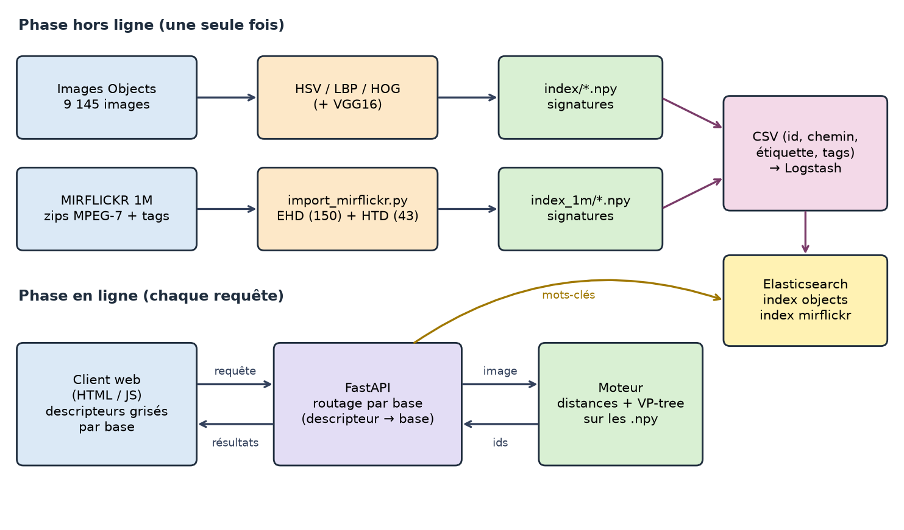

### Phase hors ligne : construire les signatures et les index

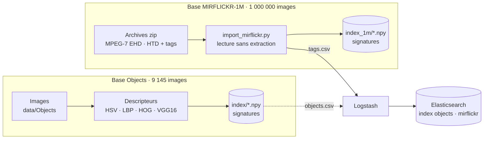

Les **signatures** (grandes matrices) restent dans des fichiers NumPy : le VP-tree en a besoin en mémoire.
Les **informations de chaque image** (identifiant, chemin, étiquette, mots-clés) sont dans **Elasticsearch**.
Les **images** restent dans des dossiers ; les vignettes de MIRFLICKR sont lues **directement dans les zips**
(aucune extraction de 1 000 000 de petits fichiers).

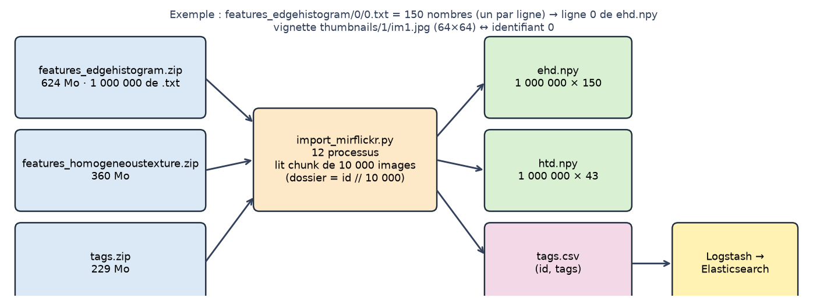

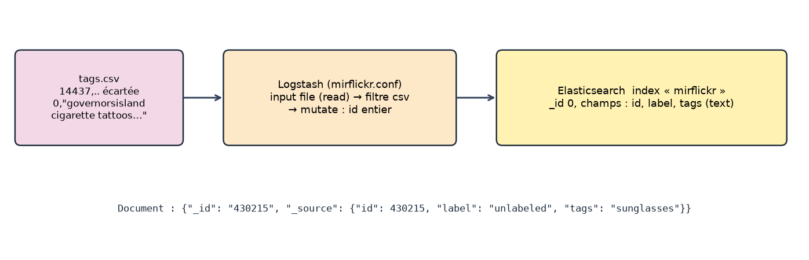

### Phase en ligne : traiter une requête

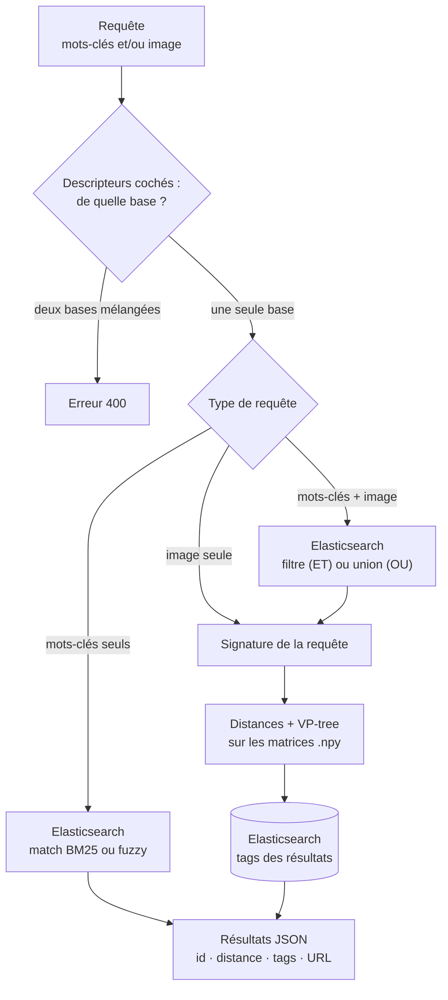

### Déroulement d'une recherche par image

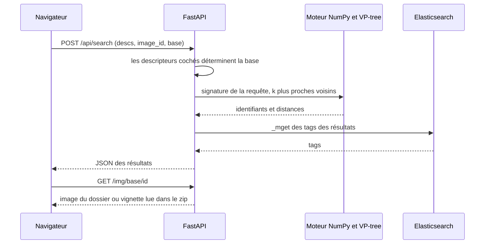

### Un descripteur appartient à une seule base

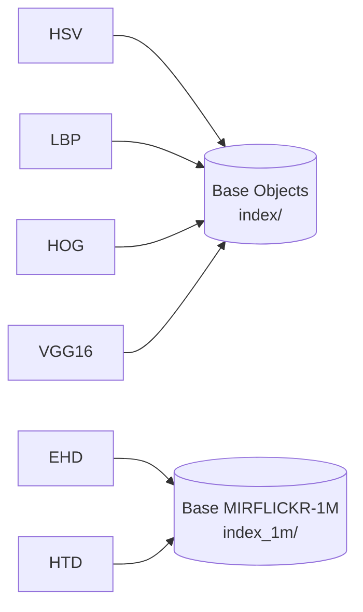

Les signatures de deux descripteurs différents n'ont ni la même taille ni le même sens : on ne les concatène jamais.
Pour combiner plusieurs descripteurs **d'une même base**, chaque distance est divisée par sa valeur moyenne entre paires
aléatoires, puis les distances sont additionnées avec les poids choisis (le résultat reste une métrique, donc le VP-tree reste valable).

### Le VP-tree

Chaque nœud choisit un point de référence et la distance médiane μ : la moitié des points tombe à l'intérieur (d ≤ μ),
l'autre à l'extérieur. Grâce à l'inégalité triangulaire, une recherche saute les sous-arbres qui ne peuvent pas contenir
de meilleur voisin. La recherche reste **exacte**.

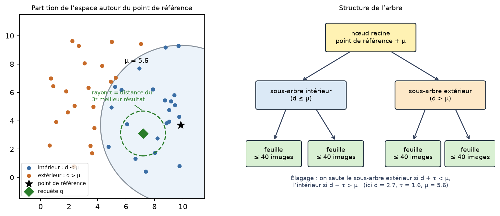

## 🧬 Les descripteurs

| Descripteur | Décrit | Taille | Base | Distance par défaut |
|---|---|---:|---|---|
| **HSV** | couleur (histogramme 8×8×8) | 512 | Objects | √χ² |
| **LBP** | texture (59 motifs uniformes) | 59 | Objects | √χ² |
| **HOG** | forme (gradients orientés, 128×64) | 3 780 | Objects | L2 |
| **VGG16** | contenu sémantique (couche `fc1`) | 4 096 | Objects | L2 / cosinus (seuil 0,2) |
| **EHD** | contours, MPEG-7 *Edge Histogram* | 150 | MIRFLICKR-1M | L1 |
| **HTD** | texture, MPEG-7 *Homogeneous Texture* | 43 | MIRFLICKR-1M | L2 |

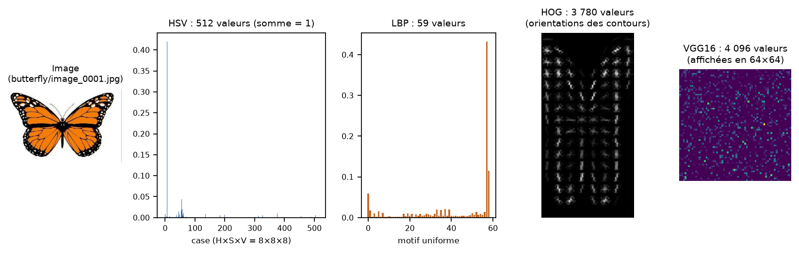

## 🚀 Démarrage rapide

Python **3.10 à 3.12** (TensorFlow ne fonctionne pas avec 3.13 et plus).

```bash
git clone https://github.com/EyaKam/CBIR-content-based-image-search.git
cd CBIR-content-based-image-search
python -m venv .venv
.venv\Scripts\activate            # Linux / macOS : source .venv/bin/activate
pip install -r requirements.txt
```

Placez les images de la base Objects dans `data/Objects/` (une archive `idb.zip` fournie par l'enseignant), puis :

```bash
python scripts/build_index.py --root data/Objects --desc hsv lbp hog     # environ 40 s
python -m uvicorn server:app --port 8000                                  # http://localhost:8000
```

Test automatique (dans un autre terminal, serveur lancé) :

```bash
python scripts/smoke_test.py
```

Pour ajouter VGG16, Elasticsearch/Logstash et la base MIRFLICKR-1M (environ 4 Go à télécharger avec
`python scripts/download_mirflickr.py`), suivez les niveaux 2 à 4 du [guide de démarrage](docs/GUIDE_DEMARRAGE.md).

## 📊 Résultats

### Qualité de la recherche (base Objects)

200 requêtes tirées au hasard ; les images de la même classe sont pertinentes (la requête est exclue).

| Descripteurs | P@10 | AP |
|---|---:|---:|
| HSV (couleur) | 0,260 | 0,290 |
| LBP (texture) | 0,310 | 0,312 |
| HOG (forme) | 0,422 | 0,433 |
| **VGG16 (profond)** | **0,813** | **0,774** |
| HSV + LBP + HOG + VGG16, poids égaux | 0,568 | 0,581 |

- **VGG16 est de loin le meilleur.** Combiner les quatre descripteurs à poids égaux est **moins bon** que VGG16 seul : les trois
  autres tirent le classement vers le bas ; les poids de l'interface servent à corriger cela.
- **La distance compte** : sur cette base, L1 et √χ² font mieux que L2 pour HSV et HOG (HOG : AP 0,52 avec L1 contre 0,43 avec L2, valeur utilisée par défaut).

Une même requête (butterfly), six résultats par descripteur. Cadre vert : même classe. HSV ramène des images de même couleur (le personnage Garfield), LBP échoue ici, HOG trouve des papillons de formes proches, VGG16 trouve des papillons de toutes couleurs.

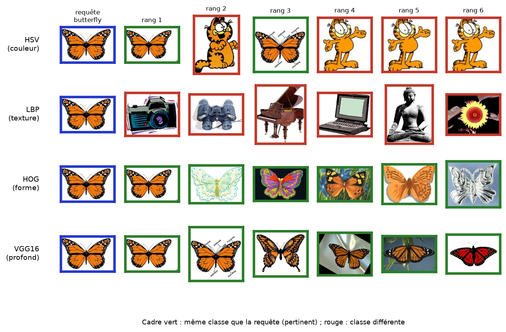

### VP-tree contre recherche exhaustive (k = 10, résultats identiques dans tous les cas)

| Base · descripteur | Dimension | Distances calculées par le VP-tree | Temps par requête (exhaustive → VP-tree) |
|---|---:|---:|---|
| MIRFLICKR-1M · **HTD** | 43 | **5 %** (53 282 sur 1 000 000) | 134 ms → **56 ms** |
| MIRFLICKR-1M · EHD | 150 | 40 % | 452 ms → 407 ms |
| MIRFLICKR-1M · EHD + HTD | 193 | 32 % | 547 ms → 591 ms |
| Objects · LBP | 59 | 24 % | 3,9 ms → 2,7 ms |
| Objects · HOG, VGG16 | 3 780 · 4 096 | ≈ 100 % | plus lent que l'exhaustive |

Le gain dépend fortement de la **dimension** : excellent à 43 dimensions, nul au-delà de quelques milliers
(« malédiction de la dimension »). Avoir moins de distances à calculer ne garantit pas un temps plus court,
car le parcours de l'arbre est écrit en Python.

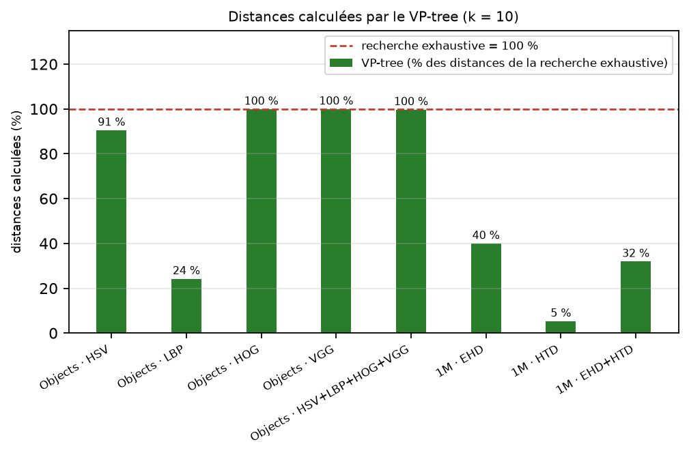

### Quelques exemples

| Interface, base Objects (VGG16) | Mots-clés « sunglasses » (Elasticsearch) |
|---|---|
|  |  |

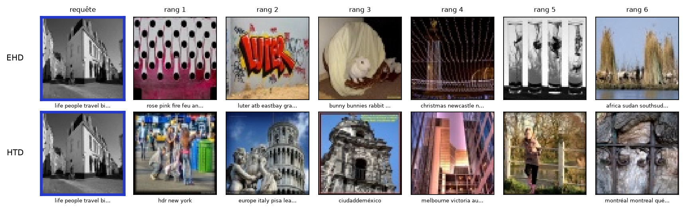

## 🔌 API

`POST /api/search` (multipart) : `keywords`, `kw_mode` (and/or), `combine` (and/or), `image_id` ou `file`, `base`
(objects/mirflickr), `descs` (ex. `hsv,lbp,hog` ou `ehd`), `weights` (JSON), `metric` (default/l1/l2/chi2), `k`,
`method` (vptree/brute). La base est déduite des descripteurs ; mélanger deux bases renvoie une erreur 400.

| Route | Rôle |
|---|---|
| `GET /api/info` | bases, nombre d'images, classes, descripteurs |
| `GET /api/browse?base=` | images aléatoires pour choisir une requête |
| `GET /img/{base}/{id}` | image ou vignette |
| `POST /search_by_text`, `POST /search_by_image/` | routes compatibles avec le projet de référence (base Objects) |

Documentation interactive : `http://localhost:8000/docs`.

## 🗂 Structure du dépôt

```
├── server.py                  # API FastAPI + service des images
├── docker-compose.yml         # Elasticsearch, Logstash (profil ingest), application
├── Dockerfile
├── requirements.txt
├── cbir/                      # bibliothèque
│   ├── config.py              # bases, registre descripteur -> base, paramètres
│   ├── descriptors.py         # HSV, LBP, HOG, VGG16
│   ├── distances.py           # L1, L2, χ², cosinus
│   ├── vptree.py              # VP-tree
│   ├── indexing.py            # phase hors ligne (base Objects)
│   ├── engine.py              # phase en ligne : requête -> résultats
│   ├── esclient.py            # client Elasticsearch
│   ├── thumbs.py              # vignettes lues dans les zips
│   └── textsearch.py          # BM25 de secours sans Elasticsearch
├── scripts/                   # build_index, import_mirflickr, download_mirflickr, create_es_indices,
│                              # make_objects_csv, evaluate, smoke_test, benchmark_scale
├── logstash/pipeline/         # objects.conf, mirflickr.conf
├── static/index.html          # interface web
├── tests/                     # 23 tests unitaires
└── docs/                      # guide de démarrage (md + pdf) et figures
```

Les images (`data/`) et les signatures (`index/`, `index_1m/`) ne sont pas versionnées : elles se reconstruisent avec les
commandes du guide.

## ⚖️ Choix de conception et limites

- **Deux bases séparées** plutôt qu'un index unique : les descripteurs MPEG-7 et les nôtres ne vivent pas dans le même espace.
- **Signatures en fichiers `.npy`, pas en base** : le VP-tree travaille sur la matrice en mémoire ; relire des lignes en base
  à chaque recherche serait bien plus lent. Elasticsearch stocke ce qu'il fait bien : texte et métadonnées.
- **Vignettes plutôt qu'images d'origine** pour MIRFLICKR-1M : la recherche n'a besoin que des signatures ; les pixels ne servent
  qu'à l'affichage (10 archives de 12 Go évitées).
- **Pas d'image envoyée sur MIRFLICKR-1M** : nous n'avons pas d'extracteur MPEG-7 ; on cherche à partir d'une image de la base.
- **5,4 % des images de MIRFLICKR-1M n'ont aucun tag** (53 887) : elles ne sont trouvables que par leur contenu visuel.
- **VP-tree inefficace en grande dimension** (HOG, VGG16) ; première requête d'une combinaison : 10 à 25 s de construction de l'arbre.
- Le service `cbir` de `docker-compose.yml` n'a pas été testé ; Elasticsearch et Logstash, eux, tournent dans Docker.

## 🙏 Crédits

- Cours « Indexation et recherche d'images par le contenu », R. Tébourbi, SUP'COM.
- Base **MIRFLICKR-1M** : M. J. Huiskes, M. S. Lew, *The MIR Flickr Retrieval Evaluation*, ACM MIR 2008 (<https://press.liacs.nl/mirflickr/>).
- VGG16 : K. Simonyan, A. Zisserman (poids ImageNet de Keras).
- Projet de référence pour le contrat d'API : *ImageText-Search-ElasticVGG-Docker*.

Auteur : Eya Kammoun · Encadrant : Riadh Tébourbi
